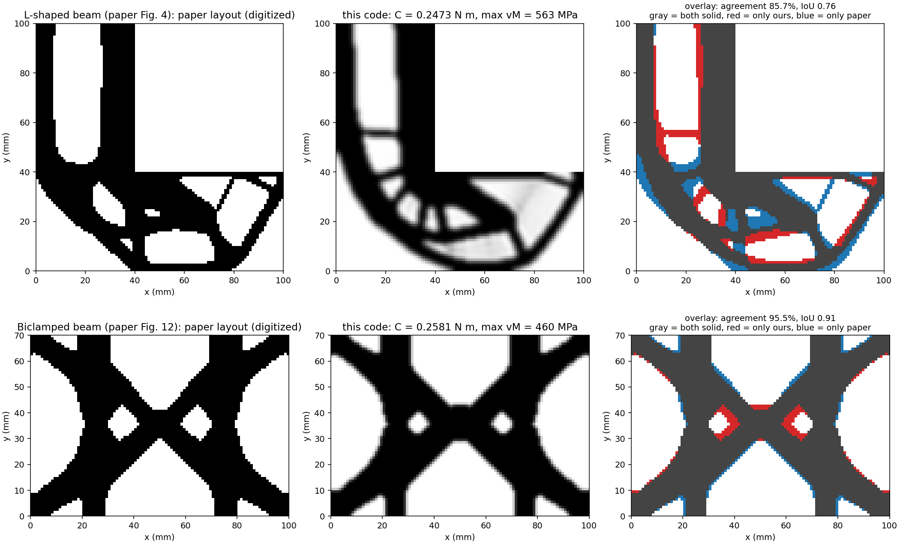

# Thermo-elastic topology optimization (stiffest design) for any 2D structure

This project implements the **compliance-minimization problem of Meng et al. (2021)**,
*Thermo-elastic topology optimization with stress and temperature constraints*,
Int. J. Numer. Methods Eng. 122:2919–2944, Eq. (23):

```
min  C = F^T U                      F = F_m + F_th(rho, T)        (thermal load, Eq. 9-14)
s.t. K_m(rho) U = F                 (Eq. 4)
     K_T(rho) T = P                 (Eq. 1)
     sum(rho_e v_e) <= V_f V_0      (volume)
     T_i <= Tbar_i                  (temperature at every heat source)
     0 < x_min <= x_e <= 1
```

with RAMP interpolation of stiffness, conductivity and thermal-stress coefficient
(Eq. 18), a density filter (Eq. 19–21), adjoint sensitivities (Eq. 33–37 and 44–49)
and the Method of Moving Asymptotes (MMA, Svanberg). The relaxed centroid von Mises
stress of Eq. (15)–(16) is computed for reporting, as in the paper's figures (B).

**Any 2D part** can be optimized. You describe it in a small YAML file (shapes,
a polygon or a black-and-white picture, plus supports, loads, heat sources and
cooled edges) and run one command. The two paper benchmarks are just two such
files, `examples/l_beam.yaml` and `examples/biclamped_beam.yaml`.

---

## 1. Quick start (WSL / Linux / macOS / Windows)

```bash
cd thermoelastic_topopt
pip install -r requirements.txt        # numpy scipy matplotlib pyyaml pillow (all in Anaconda already)

python verify.py                       # 13 self-checks, ~2 s
python run.py examples/l_beam.yaml     # paper Fig. 4  (~15 s)
python run.py examples/biclamped_beam.yaml   # paper Fig. 12 (~15 s)
python scripts/compare_with_paper.py   # side-by-side with the paper -> results/paper_comparison.*
```

On your WSL machine use Anaconda's Python (`~/anaconda3/bin/python run.py ...`), or
activate it first with `conda activate`. `bash run_all.sh` reproduces everything in
`results/` in about 2–3 minutes. No NLopt or other compiled extras are needed: MMA is
included (`thermotopo/mma.py`).

## 2. Optimizing your own structure

1. Copy `examples/TEMPLATE.yaml` (every option is explained in it) to e.g. `my_part.yaml`.
2. Describe the geometry. The domain is a union of shapes minus other shapes:
   ```yaml
   geometry:
     element_size: 1.0
     add:      [{type: rectangle, x: [0, 120], y: [0, 60]}]
     subtract: [{type: circle, center: [20, 30], radius: 8}]
   ```
   Shape types: `rectangle`, `circle`, `polygon` (list of points) and `image`
   (a PNG where dark pixels are material; see `examples/hook_from_image.yaml`).
   Optional `passive_solid` / `passive_void` shapes are kept solid / empty.
3. Pick nodes for boundary conditions with `where:` selectors: `point`, `points`, `line`,
   `box`, `circle`, `edge: left|right|top|bottom`.
   ```yaml
   mechanical:
     supports: [{where: {edge: left}, fix: xy}]                               # x, y or xy
     loads:    [{where: {line: [[120, 27], [120, 33]]}, force: [0, -800]}]   # total N
   thermal:
     fixed_temperature: [{where: {edge: left}, value: 300}]                   # K
     heat_sources: [{name: chip, where: {point: [80, 30]}, power: 0.25, max_temperature: 318}]
   ```
4. **Check the setup first.** This only builds the model, draws `setup.png` and prints the
   temperatures of the all-solid design:
   ```bash
   python run.py my_part.yaml --check
   ```
   If the all-solid design already violates a temperature limit, the problem is
   infeasible at lower volume. Raise the limit, lower the power or add cooling.
5. Run it: `python run.py my_part.yaml`. You can change any value from the command line
   without editing the file:
   ```bash
   python run.py my_part.yaml --set optimization.volume_fraction=0.35 --out results/my_part_v35
   ```

Units: coordinates and thickness use the `units:` of the file (default `mm`). Material
data are SI (Pa, W/(m K), 1/K), forces are N, heat is W, temperatures are K.

### Included examples

| file | what it shows |
|---|---|
| `examples/l_beam.yaml` | paper Sec. 5.1, Fig. 3/4 |
| `examples/biclamped_beam.yaml` | paper Sec. 5.2, Fig. 11/12 |
| `examples/bracket_with_hole.yaml` | shape subtraction, bolt-hole support (circle selector), passive solid ring |
| `examples/roof_polygon.yaml` | polygon domain, roller support, region heat sources, mirror symmetry, aluminium |
| `examples/hook_from_image.yaml` | geometry from a picture (`hook.png`, drawn by `make_hook_image.py`) |
| `examples/TEMPLATE.yaml` | every option, documented |

## 3. What each run writes (`results/<name>/`)

| file | content |
|---|---|
| `setup.png` | domain and boundary conditions. Check this first. |
| `fields.png` | paper-style panels: (A) density, (B) von Mises stress Eq. 15, (C) temperature |
| `density.png` | the optimized layout alone, ready for a report |
| `history.png`, `history.csv` | compliance, volume and constrained temperatures per MMA iteration |
| `summary.json` | final numbers: C, V, max stress, temperatures, ‖F_th‖/‖F_m‖, grayness, iterations, status |
| `result.npz` | all fields (density, T, U, stress, mesh) for your own post-processing |
| `result.vtk` | the same for ParaView |
| `problem_used.yaml` | the exact input used, including `--set` overrides |

`results/paper_comparison.png|md` compare the two benchmarks with the paper, and
`results/parameter_study/*/study.csv|png` hold the parameter studies described below.

## 4. Matching the paper

### What is fixed by the paper, and what isn't

Taken from the paper (Sec. 5, Figs. 3 and 11, Tables 1–2): geometry, 1 mm square Q4
elements (6400 / 7000), plane stress, unit thickness (1 mm), steel properties,
T_ref = fixed temperature = 312 K, F = 500 N on 5 nodes (L) / 3500 N on a 15-node patch
(biclamped), point heat sources of 0.06 W / 0.335 W limited to 325 K, V_f = 53 % / 49 %,
x_min = 0.001, initial design x = 1, at most 200 MMA iterations, stop when C changes
< 0.1 % over 10 iterations with all constraints satisfied, and s = 0.5 in Eq. 15.
Heat-source positions were measured from the paper's temperature plots: L (20, 20) and
(70, 20) mm; biclamped (25, 35) and (75, 35) mm.

Two checks confirm this reading of the paper:
* All-solid L-beam: the source temperatures come out at 318.1 / 319.3 K. The paper's
  iteration history (Fig. 6) starts at about 318.6 K.
* Put the **paper's own layouts** (digitized from Fig. 4A / 12A) into this model and the
  results land where the paper reports them: biclamped T = 324.6 K, σ_max = 503 MPa,
  ‖F_th‖/‖F_m‖ = 0.28 (paper: 325 K, 513.8 MPa, 0.29). The two FE models agree.

**Not reported in the paper:** the RAMP penalties R_E, R_λ, R_β, the filter radius
r_min, λ_min, and the MMA settings. None of these change the equations, but they decide
which local optimum MMA finds. They were chosen with `scripts/parameter_study.py`, which
runs every combination and scores each layout by **pixel agreement** with the digitized
paper figure (`paper_reference/*.npy`):

| | R_E | R_λ | R_β | r_min | MMA move | chosen because |
|---|---|---|---|---|---|---|
| L-beam | 3 | 8 | 3 | 2.5 mm | 1.0 (Svanberg default) | best agreement of ~210 runs |
| biclamped | 8 | 8 | 8 | 1.5 mm | 0.2 | best agreement of 72 runs |

Both use λ_min = 10⁻³ λ₀ (results are insensitive to it) and the temperature constraint
written as T_i/T̄_i − 1 ≤ 0. If you prefer **one** setting for both problems, use
R_E = 3, R_λ = 8, R_β = 3, r_min = 2.5 mm, move = 1.0. That gives 85.7 % (L) and 90.9 %
(biclamped) agreement.

### Results

| | paper | **this code** | old project (best variant) |
|---|---:|---:|---:|
| **L-beam** pixel agreement with Fig. 4A | – | **85.7 %** (IoU 0.76) | 80.6 % |
| max von Mises (MPa) | 568 | **563** | 524 |
| T(H1) / T(H2) (K) | 325 / 325 | 323.1 / 325.0 | 324.0 / 325.0 |
| ‖F_th‖/‖F_m‖ | 3.42 | 2.55 | 2.20 |
| **Biclamped** pixel agreement with Fig. 12A | – | **95.5 %** (IoU 0.91) | 81.2 % |
| max von Mises (MPa) | 513.8 | 460.5 | 438.6 |
| T(H1) / T(H2) (K) | 325 / 325 | **325.0 / 325.0** | 325.0 / 325.0 |
| ‖F_th‖/‖F_m‖ | 0.29 | **0.291** | 0.25 |



* **Biclamped beam:** the paper's X layout with two holes beside the load is reproduced,
  together with the stress concentrations at the four clamped corners and the load patch,
  and the temperature field. The only visible difference is that our holes are slightly
  smaller.
* **L-beam:** the main features match: the U-shaped cut-out in the vertical arm, the
  outer arc, the bottom chord, the diagonal to the load point, and the stress peak at the
  re-entrant corner (563 vs 568 MPa). The lower-right web differs. The paper has two thin
  members there; our optimizer leaves a low-density (gray) region instead.
* In **both** cases our layout is *stiffer* than the paper's own layout analysed in the
  same model (C = 0.2473 vs 0.2585 N m for L; 0.2581 vs 0.2786 N m for biclamped), with
  the same volume and temperature limits. So the remaining shape differences are
  different local optima of a non-convex problem, plus digitization. They are not
  missing physics or a weaker optimizer.
* ‖F_th‖/‖F_m‖ depends on fine details of the layout: for the L-beam it ranges from 2.3
  to 3.2 across near-identical designs, and the paper's own layout gives 2.8–3.7 here
  depending on the filter radius.
  Treat it as an order-of-magnitude check: thermal load dominates for the L-beam and is
  minor for the biclamped beam, as in the paper.

### Reproducing the parameter study

```bash
python scripts/parameter_study.py examples/biclamped_beam.yaml --mask paper_reference/fig12A_biclamped.npy \
   --grid ramp_stiffness=3,5,8 ramp_conductivity=3,8 ramp_thermal_stress=3,8 filter_radius=1.5,2,2.5 \
          move_limit=0.2,1.0 temperature_scaling=normalized --jobs 8
```
Any key of the `optimization:` block can be swept, and the study runs in parallel.
`paper_reference/digitize.py` shows how the paper figures were digitized.

## 5. Code layout

```
run.py                     command-line entry point (problem file -> results folder)
verify.py                  self-checks: element null-spaces, thermal patch test, paper data,
                           adjoint-vs-finite-difference gradients, MMA test problem
run_all.sh                 reproduce all results
thermotopo/
  config.py                read YAML/JSON, unit conversion, build mesh + problem
  geometry.py              shapes: rectangle, circle, polygon, image; union / subtraction
  mesh.py                  structured Q4 mesh of any domain, node selectors, symmetry maps
  fem.py                   Q4 plane-stress / conduction / thermal-load element matrices, assembly
  problem.py               Meng Eq. (23): state solves, RAMP, filter, adjoint sensitivities, stress
  mma.py                   Svanberg's MMA (mmasub + subsolv), pure NumPy
  optimizer.py             optimization loop, paper's stopping rule
  postprocess.py           figures, VTK, npz/csv/json output
scripts/
  compare_with_paper.py    paper vs. this code (figure + table)
  parameter_study.py       sweep unreported settings, score against the paper figure
paper_reference/           digitized paper layouts (Fig. 4A, Fig. 12A) + digitize.py
examples/                  problem files (paper benchmarks + general examples + template)
results/                   outputs of run_all.sh
```

## 6. What changed compared with the previous project

* **Same equations.** For identical density fields, the new FE code reproduces the old
  code's compliance, temperatures, sensitivities and stresses to about 1e-11 relative
  error (checked during the rewrite).
* **Optimizer:** the old code used NLopt's `LD_MMA`. That variant counts *function
  evaluations* rather than MMA iterations, adds inner loops, and had to start from a
  "feasible" design. It is replaced by Svanberg's classic MMA starting from x = 1 with the
  paper's iteration limit and stopping rule. NLopt is no longer needed.
* **Paper matching:** the unreported settings were chosen systematically against the
  digitized figures instead of by trial runs. Biclamped agreement went from 81 % to 96 %,
  L-beam from 81 % to 86 %.
* **General input:** geometry, BCs, loads, heat sources and all settings come from a
  problem file. Nothing is hard-coded to the two benchmarks.
* **Results:** one folder per problem with the same set of files every time.

**About the old `results/` folders:** `symmetric_coarse … symmetric_fine5` were six
successive stages of one biclamped run (coarse 2 mm mesh, then five restarts on the 1 mm
mesh with mirror symmetry imposed). `shape_coarse/fine1/fine2` were the same idea with
q = 8. `l_filter3` was an L-beam run with a 3 mm filter. The loose `*_numerics.npz`
files were the first baseline runs. None of these stages are needed any more: each
benchmark is now a single run from x = 1.

## 7. Limitations

* Structured square elements. Curved edges are represented as staircases, so refine
  `element_size` for smooth boundaries. Arbitrary unstructured meshes (e.g. from Gmsh)
  are not supported.
* Steady-state, linear, 2D plane stress, temperature-independent material properties,
  as in the paper.
* Only the **stiffest-design problem (Eq. 23)** is implemented. The paper's
  stress-constrained lightest design (Eq. 22, P-norm and SSCS) is not; stress is only
  evaluated for reporting.
* Topology optimization is non-convex. Different settings, mesh sizes or starting points
  can give different, equally valid local optima.
