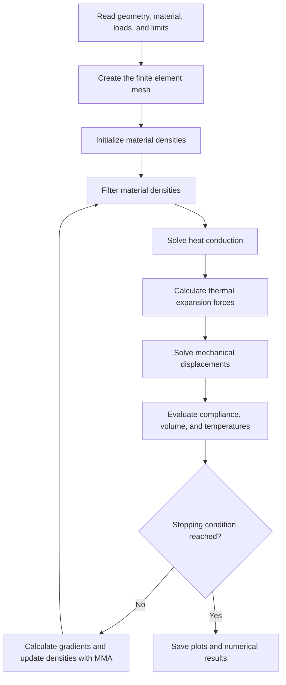

# Thermoelastic Topology Optimization

**Find where to keep material in a 2D part that must carry loads and conduct heat.**

Imagine a metal bracket that supports a weight while a nearby component heats it.
Removing material makes the bracket lighter, but can also make it bend more and
make it harder for heat to escape. Heating also causes expansion, which affects
the mechanical response.

This Python project searches for a material layout that minimizes **compliance**
(a force–displacement measure), while keeping material usage and selected
temperatures within specified limits. You describe the part in a YAML or JSON
file; the program calculates temperatures and displacements, improves the layout
iteratively, and saves plots and numerical results.

For example, the included L-shaped beam allows at most **53% of the original
material volume** and limits the two heat-source temperatures to **325 K**.

> **Scope:** the optimizer enforces volume and temperature limits. Von Mises
> stress is calculated and plotted for inspection; there is no stress-limit
> constraint in this implementation.

## Start here

- [Install and run an example](#install-and-run-an-example)
- [Understand how it works](#how-it-works)
- [Read the results](#read-the-results)
- [Define your own part](#define-your-own-part)
- [Explore the included examples](#included-examples)
- [Find the code](#project-structure)
- [Run checks and paper comparisons](#checks-and-paper-comparisons)
- [Choose what to push to GitHub](#what-to-push-to-github)
- [Understand the limitations](#limitations)

## Install and run an example

Use Python **3.10 or newer**. The project has been checked locally with Python
3.12. Its dependencies are NumPy, SciPy, Matplotlib, PyYAML, and Pillow. The MMA
optimizer is included in the source; a separate optimization package is not needed.

### 1. Get the code and create an environment

On Linux, WSL, or macOS:

```bash
git clone https://github.com/WhiteFlash14/thermoelastic_topopt.git
cd thermoelastic_topopt
python3 -m venv .venv
source .venv/bin/activate
```

On Windows, use PowerShell:

```powershell
git clone https://github.com/WhiteFlash14/thermoelastic_topopt.git
cd thermoelastic_topopt
py -3 -m venv .venv
.venv\Scripts\Activate.ps1
```

If you already have the project, open a terminal in its folder and skip the clone.
Then install the dependencies in your activated environment:

```bash
python -m pip install -r requirements.txt
```

### 2. Check the installation and problem setup

```bash
python verify.py
python run.py examples/l_beam.yaml --check
```

`verify.py` runs numerical self-checks. `--check` builds the example, saves
`results/l_beam/setup.png`, and prints compliance and monitored temperatures for
the initial all-solid design, with any prescribed void regions retained. It does
not run the optimization. Open `setup.png` to check the supports, forces, heat
sources, and fixed-temperature boundaries.

### 3. Run the optimization

```bash
python run.py examples/l_beam.yaml
```

Open `results/l_beam/density.png` for the resulting layout and
`results/l_beam/fields.png` for density, stress, and temperature together. Read
`summary.json` to check whether the constraints were satisfied.

Runtime depends on the mesh, iteration count, and computer. Reusing an output
folder replaces files with the same names. Use `--out` to keep a separate run:

```bash
python run.py examples/l_beam.yaml --out results/l_beam_trial
```

## How it works

**Topology optimization** chooses where material should remain inside an allowed
region. The region is divided into small square finite elements, each with a
material density, written as `rho`:

| Density | Meaning in this model |
|---|---|
| `1` | Solid material |
| Near `0.001` with the default settings | Almost empty; a small residual density is retained for numerical stability |
| Between these values | An intermediate material density during optimization |

These are design variables describing material distribution, not a material's
mass density in kg/m³. Intermediate densities can remain in the final solution.



The key terms are:

| Term | What it means here |
|---|---|
| Finite element analysis, or FEA | Approximate the part with connected small elements and solve for its response |
| Compliance | `C = FᵀU`, combining total forces `F` and displacements `U`; the objective being minimized |
| Volume fraction | Average material density; `0.5` permits up to half the original domain volume |
| Fixed-temperature boundary | Nodes held at a specified temperature, providing a path for heat to leave |
| Thermal load | Equivalent mechanical forces arising from thermal expansion |
| Density filter | Averages nearby design values to reduce alternating solid/void checkerboard patterns |
| RAMP | A nonlinear rule relating density to stiffness, conductivity, and thermal loading |
| Sensitivity or gradient | How a result changes when a design variable changes |
| MMA | Method of Moving Asymptotes, the algorithm that updates the material layout |

For fixed forces, lower compliance means less deformation in the direction of
those forces. Here, thermal forces also depend on the layout, so comparisons
should use the same geometry, loading, material, and thermal boundary conditions.

### What `analyze()` does

[`ThermoelasticCompliance.analyze()`](thermotopo/problem.py) evaluates one density
layout. It first solves temperatures, then thermal forces and displacements, and
returns compliance, volume fraction, and monitored temperatures. By default it
also calculates their density gradients using adjoint equations. Calling it with
`sensitivities=False` skips the gradients.

[`optimize()`](thermotopo/optimizer.py) repeatedly calls `analyze()`, converts those
gradients through the density filter and symmetry mapping, and passes them to MMA
for the next design update. Stress is evaluated separately during post-processing.

<details>
<summary>Equations and implementation details</summary>

The implemented problem is:

```text
Minimize:       C = FᵀU

Subject to:    K_T(rho) theta = P
               K_m(rho) U = F_m + F_th(rho, theta)
               mean(rho) <= volume_fraction
               T_i <= temperature_limit_i at specified locations
               x_min <= x_e <= 1

where:         theta = T - T_ref
               x = element design variables before density filtering
               rho = physical densities after filtering and passive-region overrides
```

The discretization uses four-node square elements (Q4), 2 × 2 Gauss integration,
linear plane-stress elasticity, and steady heat conduction. RAMP interpolation
scales stiffness, conductivity, and thermal loading. Adjoint equations provide
gradients without independently perturbing every element density.

Optimization stops when relative compliance changes stay below `tolerance` for
`window` consecutive iterations and the volume and temperature constraints meet
the optimizer's tolerances, or when `max_iterations` is reached.

</details>

## Read the results

By default, each run writes to `results/<name>/`. A problem's `output.directory`
setting or the command-line `--out` option can change this location.

| File | What to look for |
|---|---|
| `setup.png` | Geometry and boundary conditions; inspect this before trusting a run |
| `density.png` | Material layout: black is solid, white is empty, gray is intermediate density |
| `fields.png` | Density, reported von Mises stress in MPa, and temperature in K |
| `history.png` | How compliance, material volume, and monitored temperatures changed each iteration |
| `history.csv` | The iteration history as a spreadsheet-readable table |
| `summary.json` | Final compliance, volume, temperatures, stress, iteration count, status, and feasibility |
| `result.npz` | NumPy arrays for densities, nodal temperatures, displacements, stress, and mesh data |
| `result.vtk` | Fields for inspection in ParaView or another VTK viewer |
| `problem_used.yaml` | Input settings used for this run, including command-line overrides |

In `summary.json`, check:

- `feasible`: whether the volume and monitored temperature constraints passed the
  optimizer's tolerances. This field does not assess stress or manufacturing requirements.
- `status`: `converged` means the stopping rule was satisfied. `max_iterations`
  means the iteration budget ended; check feasibility and the history before
  treating the design as finished.
- `constrained_temperatures_K` and `temperature_limits_K`: the monitored values
  and their limits. `T_max_domain_K` is the maximum nodal temperature anywhere,
  which can differ from the monitored values.
- `gray_fraction_0p1_0p9`: the fraction of elements with intermediate densities
  between 0.1 and 0.9. A gray layout is not yet a simple solid/empty geometry.

## Define your own part

For a fully commented starting point, copy [`examples/TEMPLATE.yaml`](examples/TEMPLATE.yaml).
Alternatively, save this smaller example as `my_part.yaml` in the project root:

```yaml
name: my_part
units: mm

geometry:
  element_size: 1.0
  add:
    - {type: rectangle, x: [0, 40], y: [0, 20]}

material:
  thickness: 1.0
  reference_temperature: 300.0
  # Other material properties default to steel; see examples/TEMPLATE.yaml.

mechanical:
  supports:
    - {where: {edge: left}, fix: xy}
  loads:
    - {where: {point: [40, 10]}, force: [0, -100]}

thermal:
  fixed_temperature:
    - {where: {edge: left}, value: 300.0}
  heat_sources:
    - name: chip
      where: {point: [30, 10]}
      power: 0.02
      max_temperature: 315.0

optimization:
  volume_fraction: 0.5
  filter_radius: 1.5
  max_iterations: 200
```

This describes a 40 × 20 × 1 mm plate, fixed and cooled along its left edge, with
a 100 N downward force on the right and a 0.02 W heat source inside. Up to half
its original material volume may remain. The source temperature must stay at or
below 315 K.

Check and run it from the project root:

```bash
python run.py my_part.yaml --check
python run.py my_part.yaml
```

### Geometry and boundary conditions

- Build the domain with `geometry.add` shapes and remove regions with
  `geometry.subtract`. Supported shapes are rectangles, circles, polygons, and
  images. For images, dark pixels define the allowed domain; image paths are
  relative to the input file.
- Use `passive_solid` for material that must remain, such as a bolt ring, and
  `passive_void` for regions that must stay nearly empty.
- Select boundary-condition nodes using `point`, `points`, `line`, `box`,
  `circle`, or `edge: left|right|top|bottom`. `edge` refers to the mesh's bounding
  box. Use `setup.png` to confirm the selected locations.
- `fix: x`, `y`, or `xy` controls which displacement directions are restrained.
  Supports must prevent rigid-body motion, and at least one fixed-temperature
  boundary is required.
- `force: [Fx, Fy]` is the **total** force split across the selected nodes by
  default. `per_node: true` applies that force to each selected node instead.
- A heat source's `power` is the **total** power shared across its selected nodes.
  For a point source, `max_temperature` constrains the interpolated temperature
  there; for a region, it creates a constraint at each selected node.
- Use `thermal.temperature_limits` to constrain additional monitored points
  without adding heat sources.

### Units

| Quantity | Unit |
|---|---|
| Coordinates, element size, filter radius, thickness | Input file's `units`: `mm` by default; also `m`, `cm`, `um`, or `in` |
| Young's modulus | Pa |
| Thermal conductivity | W/(m K) |
| Thermal expansion coefficient | 1/K |
| Force | N |
| Heat input | W |
| Temperature | K, not °C |

The solver converts lengths to metres internally. Saved displacement arrays use
metres; the exported mesh coordinates retain the input length unit.

### Change settings without editing the file

```bash
python run.py examples/l_beam.yaml --set optimization.volume_fraction=0.45 --out results/l_beam_v45
python run.py examples/l_beam.yaml --set optimization.max_iterations=20 --out results/l_beam_short
python run.py examples/biclamped_beam.yaml --quiet
python run.py --help
```

A short run is useful for exploring the program, but can stop before the layout
converges or satisfies its constraints. If temperatures exceed their limits,
check the heat input, cooling boundaries, material allowance, and convergence
history. `--check` is a setup check, not proof that the optimization is feasible.

## Included examples

| File | What it demonstrates |
|---|---|
| [`l_beam.yaml`](examples/l_beam.yaml) | L-shaped benchmark with two heat sources and a 53% volume allowance |
| [`biclamped_beam.yaml`](examples/biclamped_beam.yaml) | Beam clamped at both ends, with a 49% volume allowance |
| [`bracket_with_hole.yaml`](examples/bracket_with_hole.yaml) | Circular hole, bolt support, and a passive solid ring |
| [`roof_polygon.yaml`](examples/roof_polygon.yaml) | Polygon geometry, roller support, symmetry, and aluminium |
| [`hook_from_image.yaml`](examples/hook_from_image.yaml) | Geometry read from the included `hook.png` input image |
| [`TEMPLATE.yaml`](examples/TEMPLATE.yaml) | Commented reference for the available settings |

## Project structure

```text
thermoelastic_topopt/
├── README.md                Project explanation and usage
├── requirements.txt         Python dependencies
├── run.py                   Run a problem from the command line
├── verify.py                Numerical self-checks
├── run_all.sh               Run checks, examples, and paper comparison
├── examples/                Input problems, template, and hook input image
├── thermotopo/              Solver and optimization package
│   ├── config.py            Read inputs, convert units, build the problem
│   ├── geometry.py          Shapes and domain operations
│   ├── mesh.py              Square-element mesh and node selection
│   ├── fem.py               Element matrices and sparse assembly
│   ├── problem.py           Physics solves, gradients, filtering, and stress
│   ├── optimizer.py         Analysis/update loop and stopping rules
│   ├── mma.py               Method of Moving Asymptotes implementation
│   └── postprocess.py       Plots and data exports
├── scripts/                 Optional comparison and parameter-study tools
├── paper_reference/         Reference layouts used by comparison tools
├── results/                 Generated outputs; excluded from new Git tracking
└── .venv/                   Local Python environment; excluded from Git
```

To read the source, start with `run.py`, then `config.py`, `optimizer.py`, and
`problem.py`. `fem.py` contains the element-level calculations they use.

## Checks and paper comparisons

```bash
python verify.py
```

The existing checks cover element-matrix symmetry and rigid-body modes, free
thermal expansion, benchmark geometry and loads, adjoint gradients against finite
differences, and MMA on a small problem with a known optimum.

The reference is Meng et al. (2021), *Thermo-elastic topology optimization with
stress and temperature constraints*, International Journal for Numerical Methods
in Engineering, 122:2919–2944. This project implements the compliance-minimization
formulation identified as Eq. (23) in that paper.

Run both benchmarks before generating a comparison:

```bash
python run.py examples/l_beam.yaml
python run.py examples/biclamped_beam.yaml
python scripts/compare_with_paper.py
```

The comparison script writes `results/paper_comparison.png` and
`results/paper_comparison.md`. It uses the digitized layouts in `paper_reference/`
to compare solid/void patterns and reports temperatures, stress, compliance, and
thermal-to-mechanical load ratios. Pixel agreement and intersection-over-union
(IoU) measure visual layout similarity; they do not establish physical accuracy.

For an optional four-run parameter study:

```bash
python scripts/parameter_study.py examples/l_beam.yaml --mask paper_reference/fig4A_l_beam.npy --grid ramp_stiffness=3,5 filter_radius=2,2.5 --jobs 2
```

This writes `study.csv` and `study.png` under `results/parameter_study/l_beam/`.
Reference masks must match the problem's mesh grid; keep the example mesh size
when using the supplied masks. Numerical settings affect the local optimum, so
an exact match to the published figures is not guaranteed.

On Linux, WSL, or macOS, `bash run_all.sh` runs the self-checks, both benchmarks,
their comparison, and the three additional example problems. Activate the virtual
environment first. Parameter sweeps are run separately.

## What to push to GitHub

Keep the files needed to understand, run, and reproduce the project. The
[`.gitignore`](.gitignore) excludes environments, caches, generated results, and
local environment settings from new tracking.

| Path | Push it? | Reason |
|---|---|---|
| `thermotopo/` | Yes, except `__pycache__/` | Core solver and optimizer |
| `examples/`, including `hook.png` | Yes | Runnable inputs; `hook.png` is required by the image example |
| `scripts/` | Recommended | Comparison and parameter-study tools |
| `paper_reference/` | Recommended | Small reference inputs needed for paper comparison; optional for ordinary optimization runs |
| `README.md`, `requirements.txt`, `run.py`, `verify.py`, `run_all.sh`, `.gitignore` | Yes | Documentation, dependencies, entry points, and checks |
| `.venv/` or `venv/` | No | Local Python installation; recreate it from `requirements.txt` |
| `__pycache__/`, `*.pyc`, tool caches | No | Regenerated automatically |
| `results/` | Usually no | Regenerated plots, exports, histories, and reports |
| `.env` and local `.env.*` files | No | Machine-specific settings or secrets; a placeholder `.env.example` may be committed |
| `.git/` | Do not upload manually | Local Git metadata; normal `git push` transfers the repository history |

If you want a few result images visible on GitHub, copy selected images into a
tracked `docs/images/` folder and link them here. Keep the full generated runs
under `results/`.

**Already tracked results:** adding a path to `.gitignore` does not stop tracking
files committed earlier. To remove generated results from future commits while
keeping the local files, run from the project root:

```bash
git rm -r --cached -- results
git add README.md .gitignore
git diff --cached --stat
git commit -m "Improve project guide and exclude generated results"
git push origin main
```

The removal takes effect on GitHub after the commit is pushed. Earlier commits
still contain those files. If `results/` was never tracked, skip the `git rm` line.

## Limitations

- The model is 2D, linear elastic, and steady-state, with plane-stress assumptions
  and temperature-independent material properties. It does not simulate transient
  heating, plastic deformation, or large displacements.
- Curved boundaries are approximated by square elements. Smaller elements improve
  geometric resolution but increase memory use and runtime. Unstructured meshes
  are not supported.
- Temperature limits apply at the specified monitored locations. Other locations
  can have different temperatures.
- Reported stress uses a density-relaxed, element-centroid von Mises calculation.
  The paper's separate stress-constrained minimum-weight formulation (Eq. 22) is
  not implemented.
- Different initial designs, meshes, filters, and optimizer settings can produce
  different local optima. Convergence does not establish a global optimum.
- The output is a density field. Converting it into a manufacturable solid part
  requires additional geometry processing and analysis of that resulting geometry.
